# Palestra: corsi, abbonamenti e prenotazioni

Applicazione web per la gestione di una palestra. Gli **utenti** si iscrivono ai corsi con un abbonamento, gli
**istruttori** vedono i corsi che insegnano e chi è iscritto, gli **amministratori** gestiscono corsi, istruttori,
piani di abbonamento e abbonamenti. Si possono anche prenotare le sale scegliendo uno slot libero.

Progetto da portfolio: API REST con **Laravel**, login e identità con **Keycloak** (token JWT), interfaccia a pagina
singola con **Angular** e **Angular Material**, accessibile secondo **WCAG 2.2 AA**. Tutto in un'unica repository.

```
sistema-prenotazioni/
├── booking-api/        Backend Laravel (API, code, test) e specifica OpenAPI
├── booking-frontend/   Frontend Angular
├── keycloak/           Realm di Keycloak da importare (ruoli, client, utenti di prova)
└── docker-compose.yml  Avvio dell'intera applicazione per provarla
```

> La versione precedente, con autenticazione a cookie (Sanctum) e registrazione in due passi via email, è stata
> spostata in un archivio a parte (repository locale `sistema-prenotazioni-sanctum`).

## Funzionalità

**Utente**
- Accesso e registrazione con Keycloak (con verifica dell'email)
- Elenco dei corsi con ricerca per nome, filtro per giorno e paginazione
- Iscrizione e annullamento dell'iscrizione, con posti liberi sempre aggiornati
- "I miei corsi" con il riepilogo dell'abbonamento (durata, corsi in uso e disponibili)
- Prenotazione delle sale: data, slot liberi, "Le mie prenotazioni" con annullamento
- "Il mio profilo": dati di accesso in sola lettura, pulsanti per cambiare password e nome (form mirati di Keycloak, senza la sua console) e indirizzo modificabile

**Istruttore** (non è un ruolo globale: è un'assegnazione a un corso)
- "Corsi che insegno" e, per ogni corso, l'elenco degli iscritti con nome ed email
- Può essere studente di un altro corso, ma **mai istruttore e studente dello stesso corso**

**Amministratore**
- Creazione, modifica ed eliminazione dei corsi (giorno, ora, durata, posti, sala, stato)
- Assegnazione e rimozione degli istruttori
- Piani di abbonamento (durata e numero di corsi contemporanei)
- "Utenti e abbonamenti": si cerca una persona, si vedono i suoi abbonamenti e si assegna o annulla un piano
- Gestione delle sale e delle loro fasce orarie settimanali

## Screenshot

| | |
|---|---|
| **Accesso (Keycloak)** | **Elenco dei corsi** |
| 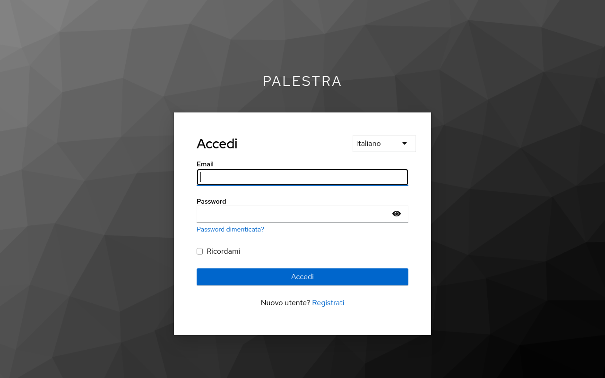 | 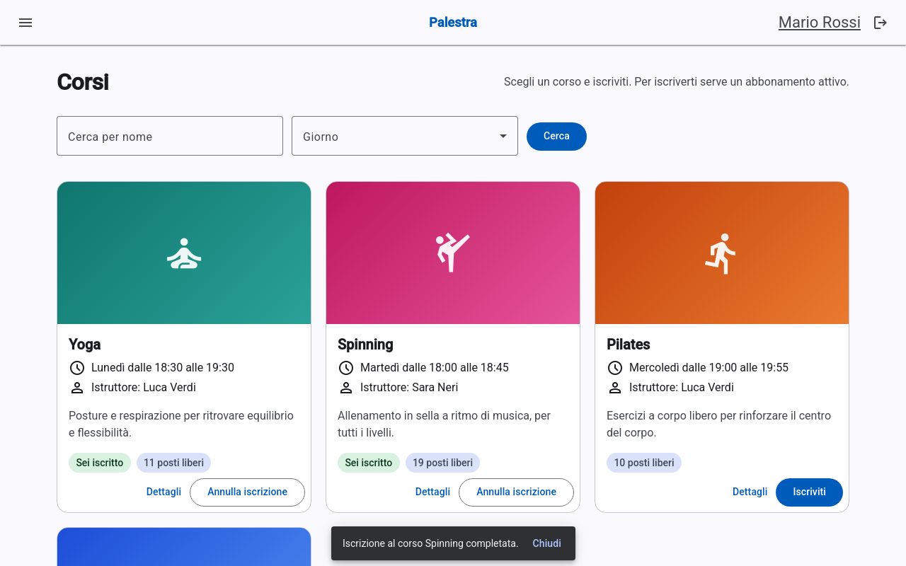 |
| **I miei corsi e l'abbonamento** | **Corso visto da un istruttore, con gli iscritti** |
| 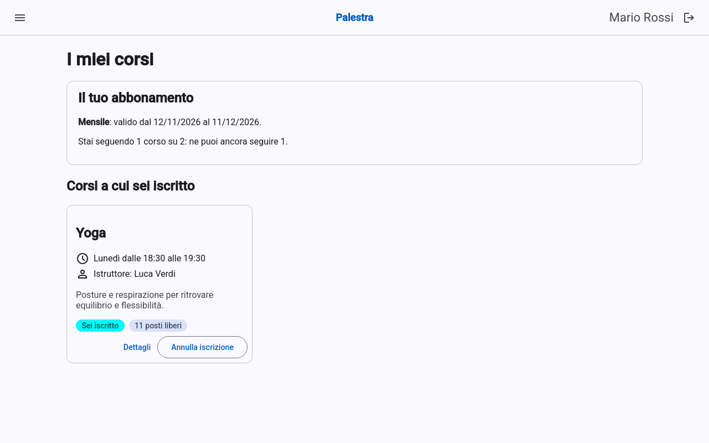 | 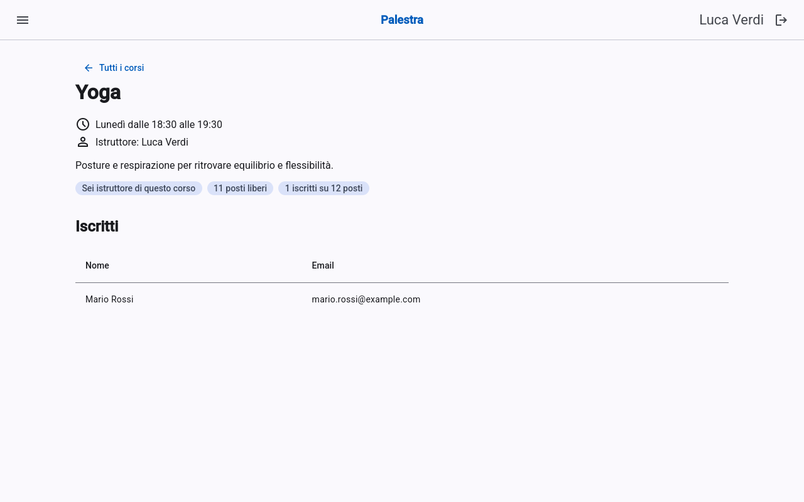 |
| **Gestione corsi (admin)** | **Utenti e abbonamenti (admin)** |
| 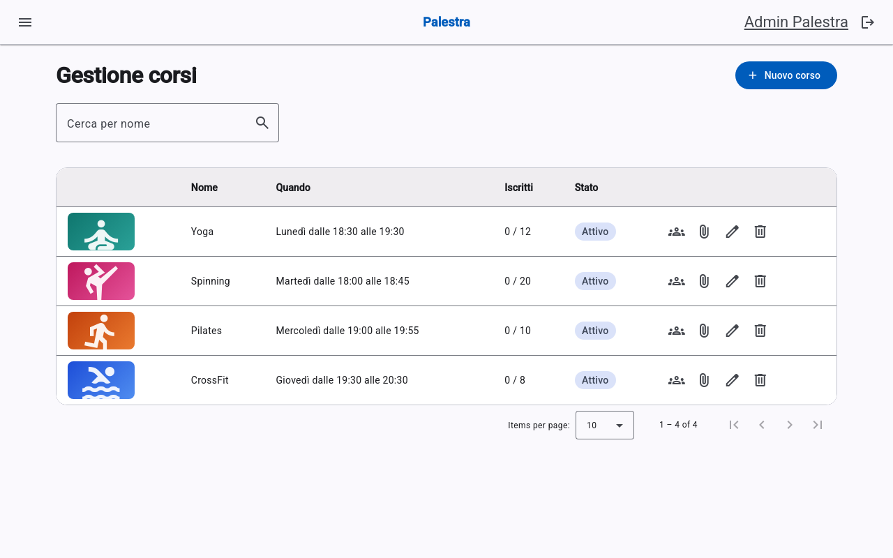 | 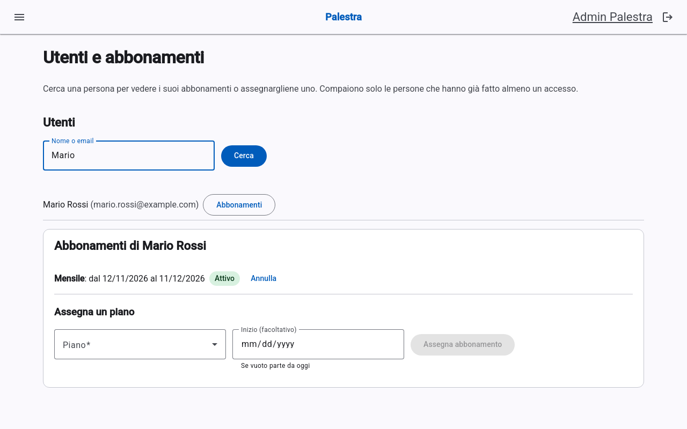 |
| **Materiali PDF di un corso (admin)** | **Il corso visto da un iscritto, con i materiali** |
| 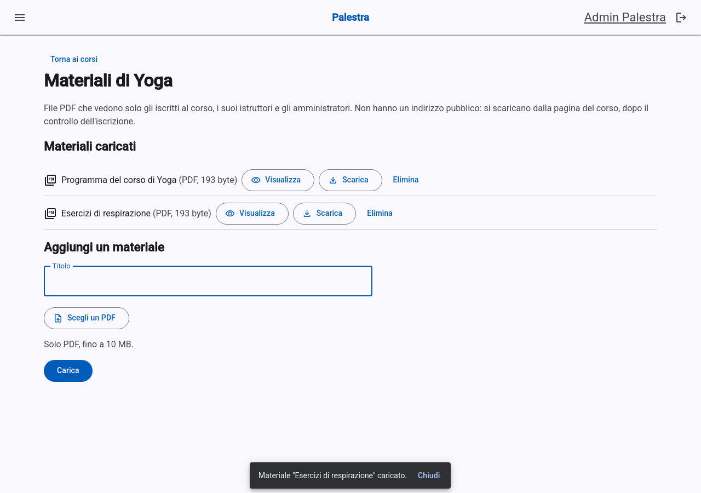 | 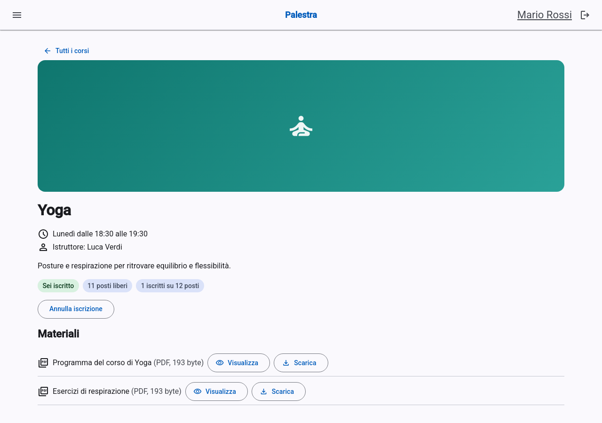 |

Dalla pagina "Utenti e abbonamenti" una finestra mostra gli abbonamenti di una persona e permette di assegnarne uno o annullarlo:

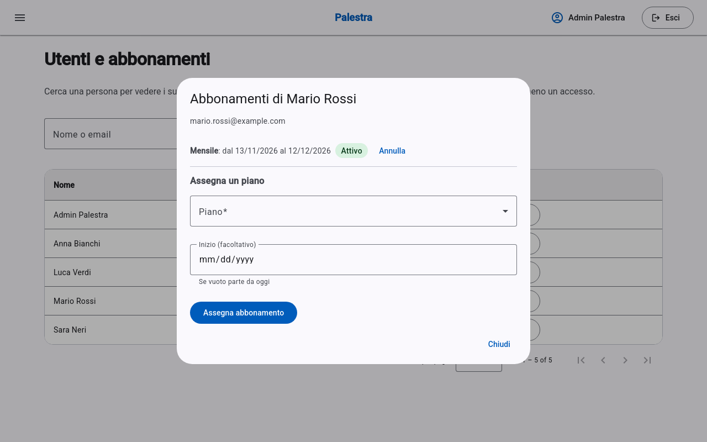

La regola "un istruttore non può essere anche studente dello stesso corso": il server la fa rispettare e l'interfaccia
mostra il motivo.

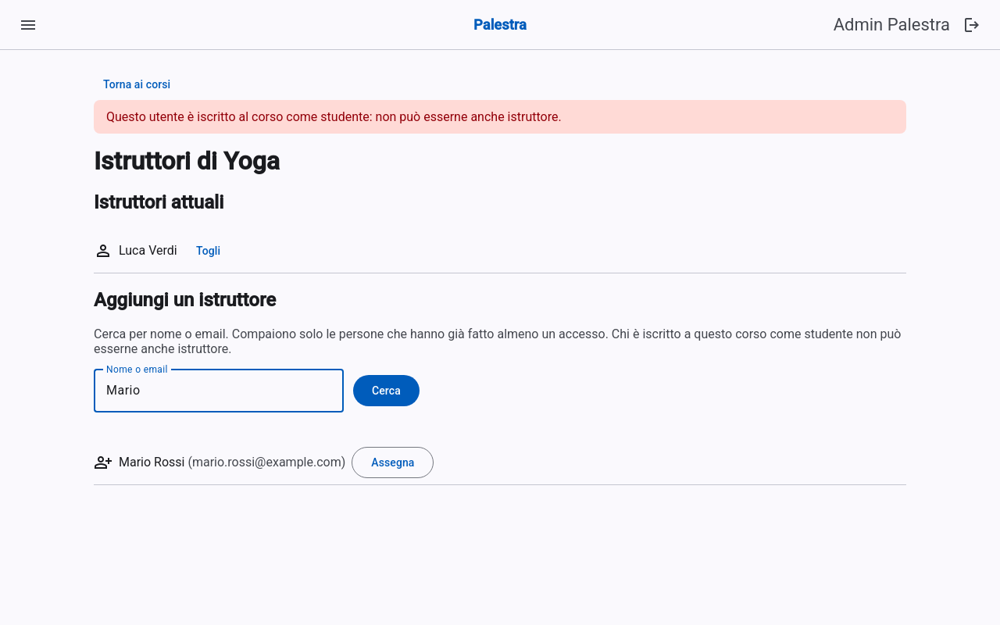

Prenotazione delle sale:

| | |
|---|---|
| 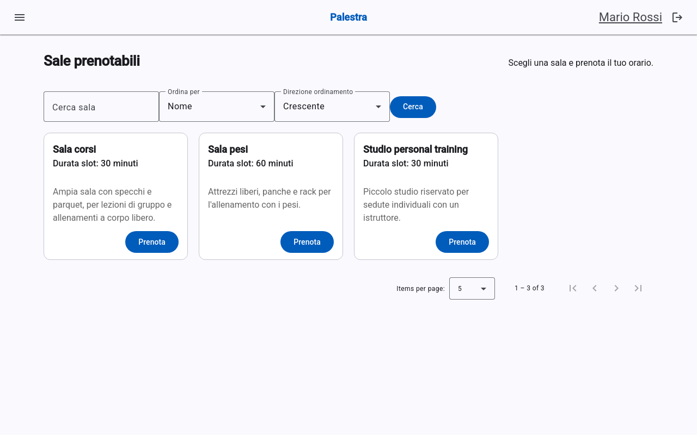 | 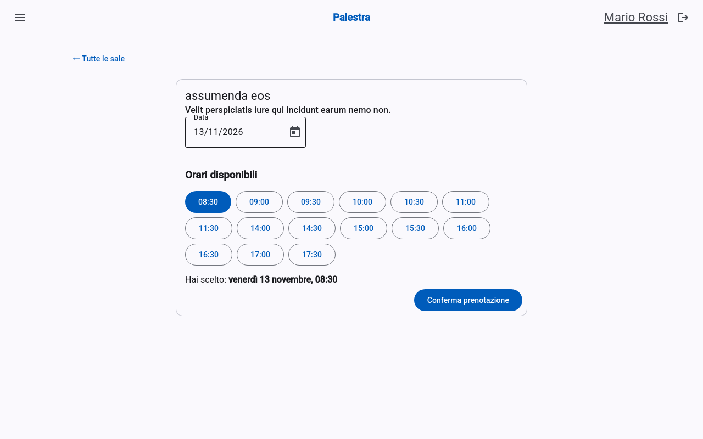 |

Il profilo: nome ed email (di Keycloak) in sola lettura con i pulsanti per cambiare password e nome, indirizzo (dell'applicazione) modificabile. L'email non è modificabile: nel realm è anche il nome utente:

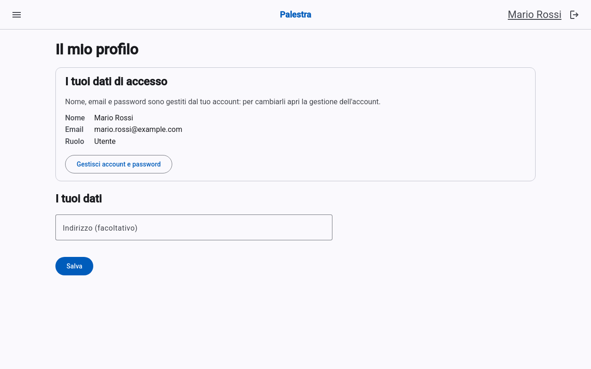

L'email di verifica inviata da Keycloak alla registrazione, letta su Mailpit:

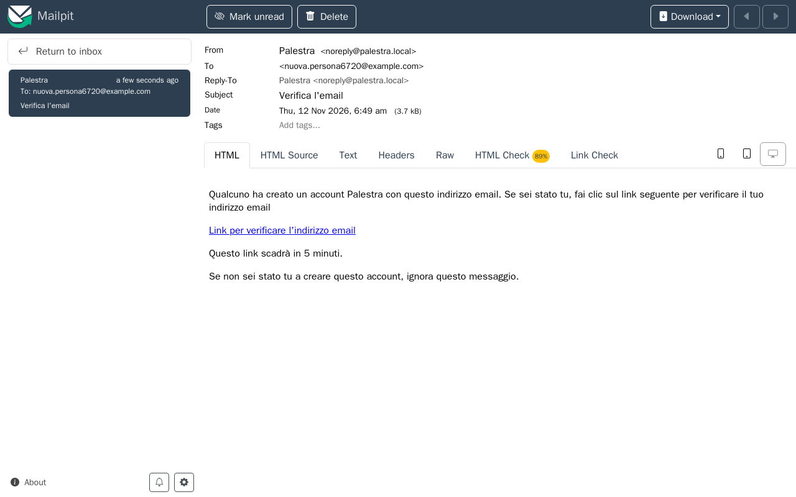

## Come funziona l'accesso

Login, registrazione e password le gestisce **Keycloak**: né il frontend né Laravel vedono mai una password.

1. Il frontend manda l'utente alla pagina di accesso di Keycloak (flusso *Authorization Code + PKCE*).
2. Keycloak rimanda al frontend un codice, che diventa un **token JWT**.
3. A ogni chiamata il frontend manda il token a Laravel: `Authorization: Bearer <token>`.
4. Laravel **verifica** il token: firma (con le chiavi pubbliche di Keycloak, tenute in cache), scadenza, emittente
   (`iss`) e destinatario (`aud`). Se qualcosa non va risponde 401.
5. L'utente esiste in due posti: in Keycloak (credenziali, ruolo `admin`) e in Laravel (profilo e dati
   dell'applicazione: corsi, abbonamenti, prenotazioni). Il profilo Laravel **nasce al primo accesso** e si allinea a
   Keycloak a ogni richiesta; il legame è il campo `sub` del token (`users.keycloak_id`).

Non ci sono cookie né protezione CSRF: il token è nell'header e il browser non lo manda da solo.

## Regole di business

**Corsi**
- Per iscriversi servono, nell'ordine: corso attivo, non essere istruttore di quel corso, non essere già iscritti,
  un **abbonamento attivo**, non superare il numero di corsi del piano, posti liberi.
- Un abbonamento è un piano assegnato a una persona per un periodo (estremi inclusi). Due abbonamenti della stessa
  persona non si sovrappongono. Annullarlo non cancella le iscrizioni già fatte.
- I posti di un corso non possono scendere sotto il numero degli iscritti; un corso con iscritti non si elimina
  (si disattiva); un piano già assegnato non si elimina (si disattiva).
- Iscrizione e assegnazione degli istruttori bloccano le righe interessate (`lockForUpdate`, sempre nello stesso
  ordine): richieste simultanee non possono superare i posti né creare uno studente-istruttore.

**Prenotazione delle sale**
- Gli slot **non sono salvati nel database**: si calcolano dalle fasce di disponibilità e dalla durata dello slot.
- La prenotazione è validata lato server (sala attiva, orario dentro una fascia, griglia degli slot, nessuna
  sovrapposizione) in una transazione con `lockForUpdate`.
- Un utente annulla fino a 2 ore prima dell'inizio, l'admin sempre. Gli istanti sono in UTC; le fasce in `Europe/Rome`.

## Accessibilità (WCAG 2.2 AA)

Il frontend è scritto per essere usabile con tastiera e lettore di schermo:
- pagina in italiano (`lang="it"`), un titolo per ogni pagina, un solo `h1` per pagina, collegamento "Salta al
  contenuto" e punti di riferimento (`header`, `nav`, `main`);
- a ogni cambio di pagina il focus passa al contenuto principale; il focus da tastiera è sempre visibile;
- ogni campo ha un'etichetta e un messaggio d'errore; l'esito delle azioni e gli errori sono annunciati ai lettori di
  schermo (`role="status"` e `role="alert"`); i pulsanti ripetuti hanno un nome che dice su cosa agiscono
  ("Iscriviti a Yoga") e che contiene il testo visibile;
- gli stati sono sempre scritti a parole ("Al completo", "Sei iscritto"), mai solo con il colore;
- gli esiti delle azioni sono avvisi a comparsa (snackbar): i successi spariscono dopo 5 secondi, gli errori restano finché si preme
  "Chiudi" (WCAG 2.2.1: un errore che sparisce da solo si rischia di non leggerlo); gli errori di caricamento restano scritti nella pagina;
- rispetto di `prefers-reduced-motion`.

**Come è verificata**: i test dei componenti includono un controllo automatico con
[axe-core](https://github.com/dequelabs/axe-core) (regole WCAG 2.x A e AA, senza il contrasto, che in jsdom non si
può misurare); inoltre ho percorso l'intera app in **Chromium vero** con axe-core, **contrasto dei colori incluso**,
su tutte le pagine principali (anonimo, studente, istruttore, admin). Limite onesto: gli strumenti automatici trovano
solo una parte dei problemi di accessibilità; non ho provato l'app con lettori di schermo reali. Le pagine di Keycloak
usano il suo tema predefinito.

## Stack

| Parte | Tecnologie |
|---|---|
| Identità e login | Keycloak 26 (OpenID Connect, PKCE), realm importato da `keycloak/palestra-realm.json` |
| Backend | Laravel, PHP, verifica dei JWT con `firebase/php-jwt` (chiavi JWKS in cache) |
| Architettura | Controller sottili → servizi (`app/Services`) → Eloquent; repository solo per le query complesse |
| Database | PostgreSQL |
| Code e scheduler | code su database (job), Mailpit per le email di prova |
| Frontend | Angular (componenti standalone, signals), Angular Material, `keycloak-js`, RxJS |
| Test | PHPUnit (backend), Vitest + axe-core (frontend) |
| Ambiente | Docker Compose per la demo, Laravel Sail per lo sviluppo |

## Prova rapida con Docker

Serve solo Docker Desktop. Dalla radice del progetto:

```bash
docker compose up --build
```

La prima volta costruisce le immagini (qualche minuto) e Keycloak impiega una trentina di secondi ad avviarsi. Poi:

| Cosa | Indirizzo |
|---|---|
| Applicazione | <http://localhost:8080> |
| Login e utenti (Keycloak) | <http://localhost:8180> (console: `admin` / `admin`) |
| Documentazione dell'API (Swagger UI) | <http://localhost:8081> |
| Email di prova (Mailpit) | <http://localhost:8025> |
| Database PostgreSQL | `localhost:5433` (solo dal tuo computer) |

**Utenti di prova** (password `password`):

| Email | Ruolo |
|---|---|
| `admin@example.com` | amministratore |
| `luca.verdi@example.com` | istruttore di Yoga e Pilates |
| `sara.neri@example.com` | istruttrice di Spinning e CrossFit |
| `mario.rossi@example.com` | studente con abbonamento Mensile attivo |
| `anna.bianchi@example.com` | studentessa **senza** abbonamento (provare l'iscrizione e vedere il rifiuto) |

Oppure clicca "Registrati": Keycloak invia la mail di verifica a Mailpit.

**Le email di Keycloak** (verifica alla registrazione e "Password dimenticata") si leggono su Mailpit, <http://localhost:8025>.
"Password dimenticata" mostra sempre lo stesso messaggio ("riceverai un'email"), **ma la manda solo se l'indirizzo appartiene a un
utente di Keycloak**: così non rivela chi è registrato. Se non arriva nulla, probabilmente l'email non è di un utente di
Keycloak (che conosce solo i cinque di prova e chi si registra dalla pagina "Registrati"). Nello sviluppo con Sail le email
di Keycloak vanno su <http://localhost:18025>, non sulla 8025 di Sail.

- Parte tutto da solo: nginx con il frontend (inoltra `/api` al backend), Laravel con FrankenPHP, worker, scheduler,
  Postgres, Keycloak, Mailpit e Swagger UI. Migrazioni e dati di prova vengono eseguiti al primo avvio.
- I dati restano nei volumi `db-data` e `keycloak-data`: sopravvivono a riavvii e a `docker compose up --build`.
  `docker compose down` ferma tutto e li conserva; `docker compose down -v` li cancella.
- **Se avevi già avviato una versione precedente** con gli stessi volumi, esegui una volta `docker compose down -v`:
  i dati di prova (corsi, piani, utenti collegati a Keycloak) si creano solo su un database vuoto.
- Per guardare il database (DBeaver, `psql`): host `localhost`, porta `5433`, database, utente e password `booking`.
- Se le porte sono occupate: `WEB_PORT=9090 MAILPIT_PORT=9025 SWAGGER_PORT=9081 DB_PORT=9433 KEYCLOAK_PORT=9180 docker compose up --build`.
  Attenzione: Keycloak accetta il ritorno dal login solo agli indirizzi elencati in `keycloak/palestra-realm.json`
  (`localhost:8080`, `localhost:4200`, `localhost:8081`); cambiando `WEB_PORT`, `SWAGGER_PORT` o `KEYCLOAK_PORT`
  vanno aggiornati lì (e in `booking-frontend/src/environments/environment.ts` per Keycloak).

> È una configurazione **solo per provare l'app**: chiavi, password e utenti sono quelli di prova, le immagini includono
> le dipendenze di sviluppo (il seeder usa Faker), Keycloak gira in modalità `start-dev`. Il frontend è compilato in
> modalità `production` (file con l'impronta nel nome). Per lavorare sul codice si usa l'avvio qui sotto.

## Requisiti per lo sviluppo

- Docker Desktop
- Node.js 22 e npm
- Angular CLI (`npm install -g @angular/cli`)

## Avvio per lo sviluppo

### 1. Keycloak e posta di prova

Con Sail, Laravel gira in un container e Keycloak serve comunque: si avvia dal compose della radice, insieme a Mailpit
(porta 18025, perché Sail usa già la 8025). Keycloak invia lì le email di verifica.

```bash
MAILPIT_PORT=18025 docker compose up -d keycloak mailpit
```

### 2. Backend

```bash
cd booking-api
cp .env.example .env

# Prima volta: installa le dipendenze PHP con un container temporaneo (la versione PHP deve essere
# compatibile con composer.json, ^8.3)
docker run --rm -v "$(pwd)":/var/www/html -w /var/www/html \
  laravelsail/php84-composer:latest composer install --ignore-platform-reqs

./vendor/bin/sail up -d
./vendor/bin/sail artisan key:generate
./vendor/bin/sail artisan migrate --seed
```

Nel `.env` controlla `APP_TIMEZONE=Europe/Rome` e le variabili `KEYCLOAK_*` (già nel `.env.example`): l'emittente è
l'indirizzo che vede il browser (`localhost:8180`), mentre Laravel, che è in un container, scarica le chiavi da
`host.docker.internal:8180`. Il backend risponde su `http://localhost`.

**Worker della coda.** Le email dell'applicazione (conferma di prenotazione) partono solo se è acceso:

```bash
./vendor/bin/sail artisan queue:work
```

### 3. Frontend

```bash
cd booking-frontend
npm install
ng serve --proxy-config proxy.conf.json
```

L'app è su `http://localhost:4200`. Il proxy inoltra `/api` al backend. **Senza `--proxy-config` le chiamate all'API
non arrivano al backend.**

## Dati di prova

Il seeder crea i cinque utenti della tabella qui sopra (con gli stessi identificativi di Keycloak, così il profilo è già
collegato), 3 piani di abbonamento, 4 corsi con i loro istruttori, l'abbonamento di Mario e 3 sale con fasce orarie
lunedì-venerdì, 9:00-13:00 e 15:00-19:00.

> Credenziali valide solo per lo sviluppo locale: non usarle in produzione.

## Test

```bash
# Backend: 313 test (PostgreSQL, database dedicato "testing")
cd booking-api && ./vendor/bin/sail artisan test

# Frontend: 252 test (Vitest + axe-core)
cd booking-frontend && ng test --watch=false
```

- **Backend**: le rotte dell'API, i servizi e i repository, provati anche direttamente senza HTTP. L'autenticazione si
  prova con un Keycloak finto: i test generano una coppia di chiavi RSA, firmano da soli i token (anche sbagliati:
  scaduti, di un altro emittente, con firma o algoritmo falsi) e verificano che l'API li accetti o li rifiuti.
- **Frontend**: servizio di accesso, interceptor, guardie, componenti e controlli di accessibilità con axe-core.
- **Concorrenza**: un test lancia più processi PHP veri che si iscrivono nello stesso istante (8 persone per 3 posti, un piano da
  1 corso con 4 iscrizioni insieme, un doppio clic) e controlla che i blocchi del database (`lockForUpdate`) reggano.
  È una prova, non una dimostrazione: una corsa dipende dai tempi, e il test copre solo le iscrizioni.

## API

Ogni richiesta porta il token di Keycloak (`Authorization: Bearer ...`); le rotte hanno il prefisso `/api`.

La specifica completa (parametri, corpi delle richieste, risposte ed errori) è in
[`booking-api/openapi.yaml`](booking-api/openapi.yaml), scritta a mano e da tenere allineata al codice. Con Docker si
legge e si prova in Swagger UI su <http://localhost:8081>: **Authorize** porta al login di Keycloak, poi "Try it out"
funziona con il tuo token.

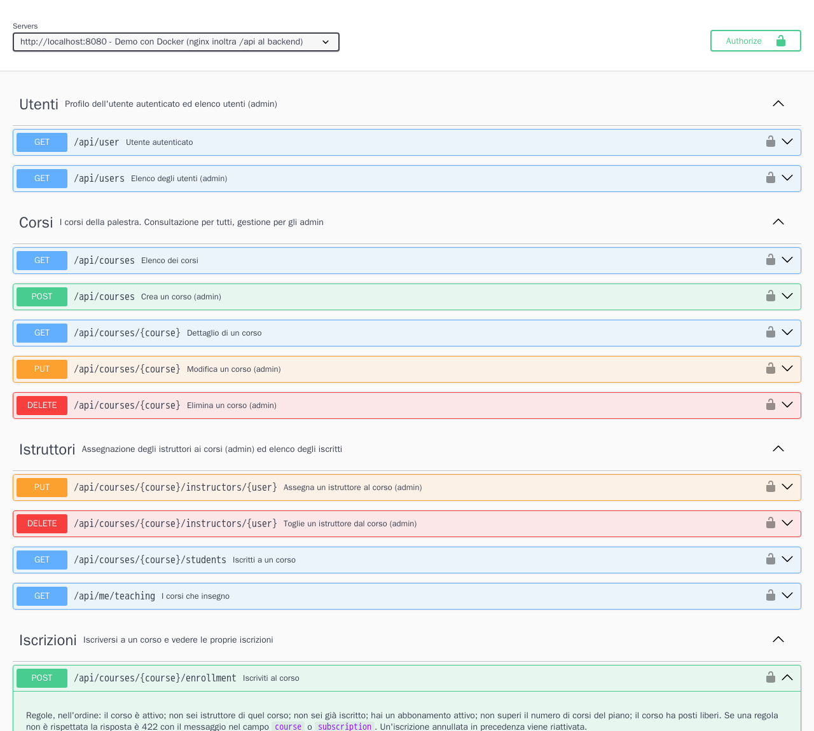

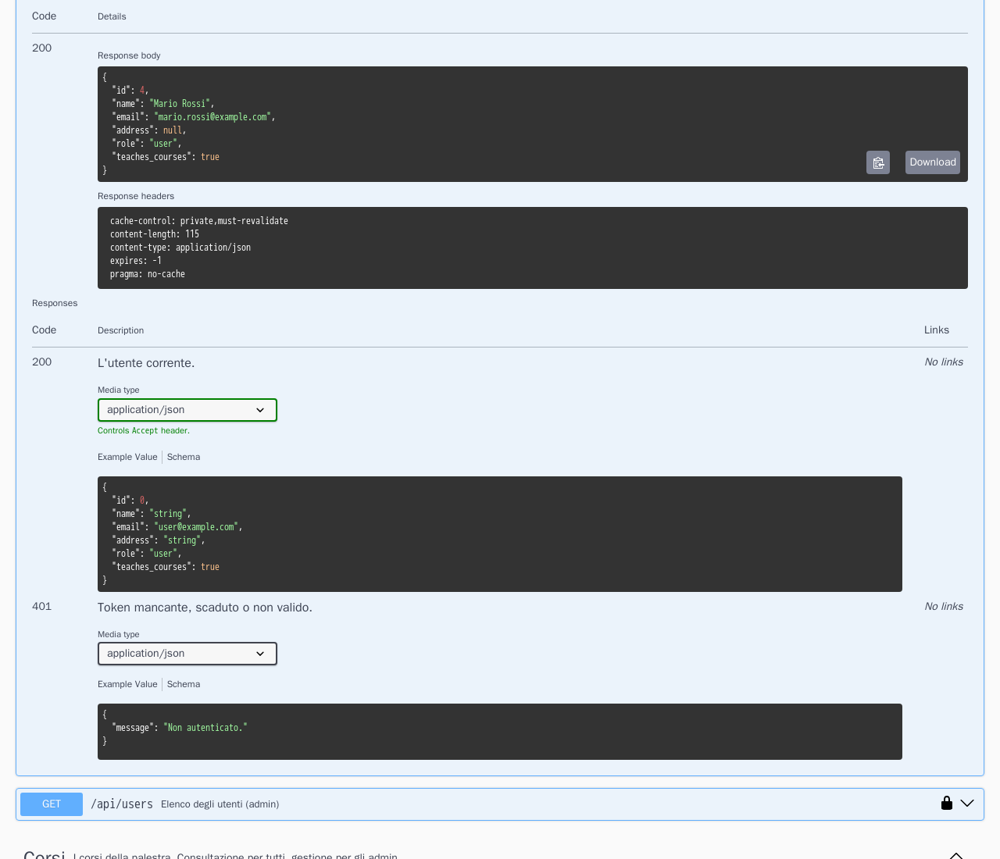

| Metodo | Percorso | Descrizione | Accesso |
|---|---|---|---|
| GET / PUT | `/user` | Profilo dell'utente (e se insegna in qualche corso) / modifica dell'indirizzo | autenticato |
| GET | `/users` | Elenco utenti, con ricerca | admin |
| GET | `/courses`, `/courses/{id}` | Corsi, con istruttori, iscritti e posti liberi | autenticato |
| POST / PUT / DELETE | `/courses`, `/courses/{id}` | Crea, modifica, elimina un corso | admin |
| GET | `/courses/{id}/image` | L'immagine del corso (pubblica: la legge un tag ``) | nessuno |
| POST / DELETE | `/courses/{id}/image` | Carica (multipart, JPEG/PNG/WebP fino a 2 MB) / toglie l'immagine | admin |
| GET | `/courses/{id}/materials`, `/courses/{id}/materials/{material}` | Elenco e file PDF dei materiali (il file passa dall'API, con il token) | admin, istruttori del corso, iscritti |
| POST / DELETE | `/courses/{id}/materials`, `/courses/{id}/materials/{material}` | Carica (multipart: `title` + `file` PDF fino a 10 MB) / elimina un materiale | admin |
| PUT / DELETE | `/courses/{id}/instructors/{user}` | Assegna / toglie un istruttore | admin |
| GET | `/courses/{id}/students` | Iscritti al corso | admin e istruttori del corso |
| POST / DELETE | `/courses/{id}/enrollment` | Iscriviti / annulla la tua iscrizione (204 senza corpo: i dati aggiornati si rileggono con `GET /courses/{id}`) | autenticato |
| GET | `/me/courses`, `/me/teaching`, `/me/subscription` | I miei corsi, quelli che insegno, il mio abbonamento | autenticato |
| GET | `/subscription-plans` | Piani di abbonamento | autenticato |
| POST / PUT / DELETE | `/subscription-plans`, `/subscription-plans/{id}` | Gestione dei piani | admin |
| GET / POST | `/users/{id}/subscriptions` | Abbonamenti di un utente / assegna un piano | admin |
| DELETE | `/subscriptions/{id}` | Annulla un abbonamento | admin |
| GET | `/bookables`, `/bookables/{id}` | Sale prenotabili, `?all=1` include le disattivate | autenticato (`all` solo admin) |
| POST / PUT / DELETE | `/bookables`, `/bookables/{id}` | Gestione delle sale | admin |
| GET | `/bookables/{id}/slots?date=AAAA-MM-GG` | Slot liberi del giorno | autenticato |
| POST / DELETE | `/bookables/{id}/availabilities`, `/availabilities/{id}` | Fasce orarie | admin |
| GET / POST | `/bookings` | Prenotazioni (le proprie; admin: tutte) / nuova prenotazione | autenticato |
| DELETE | `/bookings/{id}` | Annulla una prenotazione | proprietario o admin |
